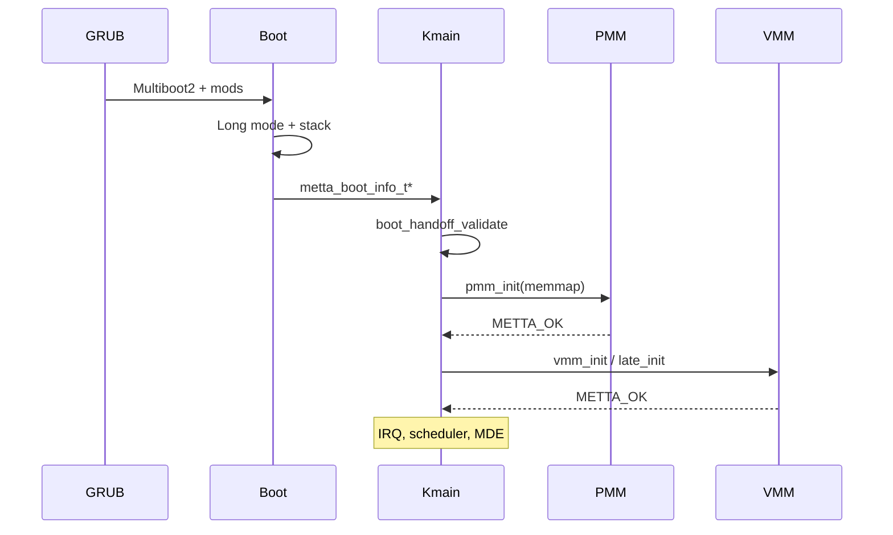

# MettaOS — Mapa de arranque y transición boot → kmain

Documento de contrato para **SA-04** (bootloader), **SA-01** (handoff) y consumidores **SA-07/08**.

---

## 1. Modelo de arranque (objetivo)

1. Firmware → cargador compatible **Multiboot2** (GRUB).
2. Stub en `boot/` (32-bit) → transición a **long mode** x86_64.
3. Entrada **`kmain(metta_boot_info_t *)`** con página de identidad temporal + stack de arranque fijo.
4. Kernel establece PMM desde memmap Multiboot, construye mapeo permanente del kernel (HHDM o rango fijo documentado abajo), luego habilita IRQ/timer (SA-06).

Este documento **no** define código de `boot/`; fija direcciones, alineaciones y contenido de `metta_boot_info_t`.

---

## 2. Layout de memoria física (fase 1 — pre-PMM)

| Rango físico (típico QEMU) | Uso | Propietario |
|----------------------------|-----|-------------|
| `[0, 1 MiB)` | Legacy, IVT, BIOS — **no asignar** | Reservado |
| `[1 MiB, kernel_load_start)` | Libre según memmap | PMM tras `pmm_init` |
| `[kernel_phys_start, kernel_phys_end)` | Imagen `.text/.rodata/.data` cargada | `METTA_FRAME_KERNEL_STATIC` |
| `[boot_stack_phys, boot_stack_phys+16KiB)` | Stack BSP arranque | Boot hasta `kmain` toma stack propio |
| `[boot_info_phys, +sizeof(metta_boot_info_t))` | Copia o vista de handoff | Boot escribe; kernel solo lectura tras validate |
| Memmap MB2 | Tags en RAM baja | Leído una vez; regiones copiadas a array propio del kernel |
| Framebuffer (si tag FB) | BPP×WxH | `pmm_mark_reserved` antes de alloc general |

**Constantes de contrato (linker + boot deben acordar con SA-03):**

```c
#define METTA_BOOT_STACK_SIZE     (16 * 1024)
#define METTA_BOOT_INFO_ALIGN       4096
#define METTA_KERNEL_PHYS_ALIGN     2 * 1024 * 1024  /* opcional 2MiB para futuras huge pages */
```

---

## 3. Layout virtual (kernel, fase estable)

Convención etapa SA-01: **mapeo superior del kernel** en canonical high half.

| Rango virtual | Permisos | Contenido |
|---------------|----------|-----------|
| `0xFFFF800000000000` … `+kernel_size` | R/X kernel | Código y rodata del kernel (HHDM físico→virt lineal) |
| `0xFFFF800000000000 + KERNEL_VIRT_DATA` | RW- kernel | `.data`, `.bss`, heap kernel inicial |
| `0xFFFFC0000000000000` … | RW- kernel | **Ventana de mapeo temporal** VMM (PTE cache, opcional) |
| `0x0000000000000000` … `0x00007FFFFFFFFFFF` | — | Espacios de usuario (por proceso, ASID ≥ 1) |
| Identidad baja `0` … `256 MiB` (transitorio) | RWX* | Solo entre salida de boot y `vmm_late_init_after_pmm` |

\* La identidad transitoria se **desmapea** salvo páginas explícitamente necesarias (MMIO FB si no hay HHDM a FB).

**`metta_boot_info_t.kernel_virt_base`** debe ser `0xFFFF800000000000` salvo revisión de contrato.

---

## 4. Construcción de `metta_boot_info_t`

El bootloader **rellena** todos los campos antes del salto a 64-bit o inmediatamente después en el trampolín:

| Campo | Fuente Multiboot2 / boot |
|-------|---------------------------|
| `magic` | Constante `METTA_BOOT_MAGIC` |
| `contract_rev` | `1` |
| `flags` | bit0: FB presente; bit1: memmap válido |
| `framebuffer_*` | Tag framebuffer |
| `memmap`, `memmap_count` | Tag memory map; boot asigna buffer estable |
| `kernel_phys_*` | Símbolos linker `_kernel_start` / `_kernel_end` físicos |
| `kernel_virt_base` | Política HHDM arriba |

### Tipos de región (`metta_mem_region_t.type`)

```c
#define METTA_MEM_AVAILABLE      1
#define METTA_MEM_RESERVED       2
#define METTA_MEM_ACPI_RECLAIMABLE 3
#define METTA_MEM_NVS            4
#define METTA_MEM_BAD            5
#define METTA_MEM_KERNEL_IMAGE   6  /* derivado: overlap con kernel_phys */
#define METTA_MEM_FRAMEBUFFER    7  /* derivado: overlap FB */
```

**Regla PMM:** solo `METTA_MEM_AVAILABLE` entra al allocator libre; `RESERVED`, kernel, FB y `<1 MiB` quedan fuera o en `pmm_mark_reserved`.

---

## 5. Secuencia en `kmain` (orden obligatorio)

```
kmain(info)
  ├─ boot_handoff_validate(info)     → panic si falla
  ├─ early_serial_init()             [SA-06, opcional antes de PMM]
  ├─ pmm_init(info->memmap, count)   → reservas kernel/FB/boot_info
  ├─ vmm_init()                      → tablas kernel, activar HHDM
  ├─ vmm_late_init_after_pmm()       → fin identidad; fijar mapeo FB si aplica
  ├─ arch_init_idt_gdt_tss()         [SA-05]
  ├─ irq/timer_init()                [SA-06]
  └─ scheduler_init() / mde_init()   [SA-09+, posterior]
```

**Puntos de no-retorno:** fallo en `pmm_init` o `vmm_init` → `panic` con código `metta_status_t` en serial.

---

## 6. Diagrama de transición



---

## 7. Stacks y CPU

| Etapa | RSP/RIP |
|-------|---------|
| Boot 32-bit | stack en `boot_stack_phys` |
| Boot 64-bit trampolín | mismo stack, alineado 16 |
| `kmain` | nuevo stack en `.bss` `kernel_main_stack[]` (SA-03 linker) |
| ISR | stacks por CPU en TSS (SA-05); fuera de este contrato |

**Alineación ABI System V AMD64:** RSP % 16 == 0 antes de `call`.

---

## 8. Compatibilidad con toolchain (SA-03)

- Enlace: kernel en físico load address acordada; símbolos `kernel_phys_start/end` exportados.
- `metta_boot_info_t` no cruza límites de página sin que boot garantice mapping identidad.

---

## 9. Errores de handoff (`boot_handoff_validate`)

| Condición | Retorno |
|-----------|---------|
| `info == NULL` | `METTA_ERR_INVALID_ARG` |
| `magic != METTA_BOOT_MAGIC` | `METTA_ERR_CORRUPT` |
| `contract_rev != METTA_CONTRACT_REV` | `METTA_ERR_CORRUPT` |
| `memmap_count == 0` | `METTA_ERR_INVALID_ARG` |
| FB flag sin dimensiones coherentes | `METTA_ERR_INVALID_ARG` |
| `kernel_phys_start >= kernel_phys_end` | `METTA_ERR_CORRUPT` |

---

*Revisión 1 — SA-01 Architecture Lead.*