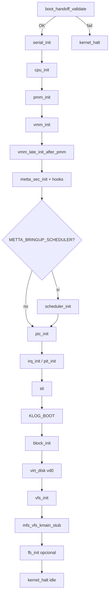

# kmain — orden de bring-up (integración mínima)

Alineado con `docs/architecture/boot-map.md` y contrato SA-01 (`METTA_CONTRACT_REV` = 1). **Solo enlaza** subsistemas existentes; no redefine PMM/VMM/CPU.

Referencia de implementación: `kernel/kernel.c`. Handoff: `boot_enter` → `kmain(&g_boot_info)` (`kernel/boot/handoff.c`).

---

## Secuencia obligatoria

| Paso | Llamada | Misión | Fallo |
|------|---------|--------|-------|
| 1 | `boot_handoff_validate(info)` | SA-04 | `kernel_halt()` **antes** de serie (sin `printk`) |
| 2 | `serial_init()` | SA-06 | — |
| 3 | `cpu_init()` | SA-05 | — |
| 4 | `pmm_init(info->memmap, info->memmap_count)` | SA-07 | `panic_fmt` |
| 5 | `vmm_init()` | SA-08 | `panic_fmt` |
| 6 | `vmm_late_init_after_pmm()` | SA-08 | `panic_fmt` |
| 7 | `metta_sec_init()` + `metta_sec_set_*` | SA-11 | — |
| 8 | `scheduler_init()` | SA-09 | opcional¹ |
| 9 | `pic_init()` → `irq_init()` → `pit_init()` | SA-06 | — |
| 10 | `sti()` | SA-05/06 | ticks PIT en vector `0x20` |
| 11 | `KLOG_BOOT(...)` | SA-12 | diagnóstico serie |
| 12 | `block_init()` | SA-25 | `panic_fmt` |
| 13 | `virt_disk_create_default` + `virt_disk_register` | SA-25 | `vd0` 16 MiB RAM |
| 14 | `vfs_init()` | SA-23 | `panic_fmt` |
| 15 | `mfs_vfs_kmain_stub()` | SA-24 | MFS en `"/"` sobre `vd0` |
| 16 | `fb_init_from_multiboot(boot_multiboot_info_raw())` | SA-14 | warning si sin FB |

¹ Definir `METTA_BRINGUP_SCHEDULER` en `0` para enlaces sin `kernel/proc/*.c`.

---

## Diagrama



---

## Seguridad (SA-11)

Tras VMM estable:

```c
metta_sec_init();
metta_sec_set_context(&(metta_sec_context_t){ .user_stack_top = 0 });
metta_sec_set_vmm_probe(fn);  /* NULL hasta vmm_probe_user_access en SA-08+ */
```

`kernel/kernel.c` registra adaptador si existe símbolo débil `vmm_probe_user_access`; si no enlaza, la sonda queda desactivada (solo validación de rango canónico).

El scheduler de usuario debe llamar `metta_sec_set_context` con `user_stack_top` al cambiar de proceso.

---

## Divergencia respecto a `boot-map.md` §5

El mapa de arquitectura lista `pmm_init` antes de `arch_init_idt_gdt_tss`. La **integración mínima actual** invoca **`cpu_init` antes de `pmm_init`** para tener IDT/GDT/TSS listos antes de asignación intensiva y para alinear con el cronograma del swarm (SA-05 + SA-06). Revisar con architecture-lead si se unifica el documento de contrato.

Tras SA-08, **`vmm_late_init_after_pmm`** va inmediatamente después de `vmm_init` y **antes** del planificador, como exige `contracts.md` (fin de identidad / HHDM).

---

## Almacenamiento (SA-23 / SA-24 / SA-25)

Tras timer e IRQ (no requiere `sti` para el disco RAM, pero el orden del swarm lo coloca **después** de `sti`):

```c
virt_disk_t vd;
block_init();
virt_disk_create_default(&vd);
virt_disk_register(&vd);
vfs_init();
mfs_vfs_kmain_stub();   /* monta "/" en vd0; formatea si vacío */
```

`mfs_vfs_kmain_stub` se declara en `kernel.c` sin incluir `mfs_vfs.h` (solo llamada; implementación en `kernel/fs/mfs/mfs_vfs.c`).

---

## Handoff y framebuffer

- `boot_multiboot_info_raw()` devuelve el puntero MB2 conservado en `boot_enter` (válido solo durante `kmain`).
- `fb_init_from_multiboot` necesita el MBI crudo; los campos en `metta_boot_info_t` son redundantes para validación.

---

## QEMU

```text
qemu-system-x86_64 -m 4096 -cdrom build/mettaos.iso -serial stdio -display none
```

Esperado tras `sti`: `[boot] kmain bring-up: irq timer on`, `[I] root MFS on vd0 mounted`, y cada segundo `[tick] N s` (PIT SA-06).

GDB: ver `docs/swarm/qemu-gdb-stub-notes.md`.

---

## Pendiente (no `kmain`)

- `scheduler_run_selftest()` / `sched_cooperative_yield` loop
- `mde_init`, subsistemas Linux
- `bootsplash.c` con `KLOG_BOOT`