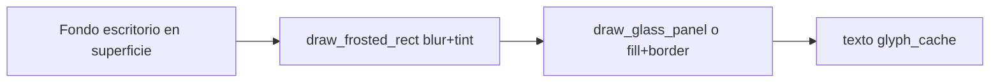

# LG-02 — Motor visual Liquid Glass (Composer 2.5)

| Campo | Valor |
|-------|-------|
| Misión | Primitivas ARGB, frosted blur CPU, panel glass compuesto |
| Agente | rasterization-typography-engineer |
| Estado | COMPLETED |
| Fecha | 2026-11-22 |
| Ámbito | `mde/gfx/` + este informe |

## Objetivo

Capa de rasterización **Liquid Glass** sobre el motor SA-16: mezcla ARGB en superficie `0x00RRGGBB`, desenfoque local 3×3 / 5×5 antes del tint, borde specular, sombra en capas y rectángulos redondeados con antialiasing de 1 px.

## Archivos tocados

| Archivo | Cambio |
|---------|--------|
| `mde/gfx/draw.h` | Helpers ARGB, API glass |
| `mde/gfx/draw.c` | Implementación AA, frosted, sombra, `draw_glass_panel` |

Firmas `draw_*` existentes sin cambios de parámetros; `draw_fill_rounded_rect` ahora delega en la ruta alpha opaca (mejor AA en esquinas).

## API nueva

### Mezcla

```c
uint32_t draw_blend_rgb(uint32_t dst_rgb, uint32_t src_rgb, uint8_t alpha);
void draw_blend_pixel(draw_surface_t *s, int32_t x, int32_t y, uint32_t argb);
void draw_fill_rect_alpha(draw_surface_t *s, int32_t x, int32_t y, int32_t w, int32_t h,
                          uint32_t argb);
void draw_fill_rounded_rect_alpha(draw_surface_t *s, int32_t x, int32_t y, int32_t w, int32_t h,
                                  int32_t radius, uint32_t argb);
```

`argb` sigue el contrato de `mde/theme/glass.h`: **0xAARRGGBB**.

### Liquid Glass

```c
void draw_frosted_rect(draw_surface_t *s, int32_t x, int32_t y, int32_t w, int32_t h,
                       int32_t radius, int32_t kernel_size, uint32_t tint_argb);
void draw_specular_edge(draw_surface_t *s, int32_t x, int32_t y, int32_t w, int32_t h,
                        int32_t radius, uint32_t specular_argb, int32_t height_px);
void draw_drop_shadow(draw_surface_t *s, int32_t x, int32_t y, int32_t w, int32_t h,
                      int32_t radius);
void draw_glass_panel(draw_surface_t *s, int32_t x, int32_t y, int32_t w, int32_t h,
                      int32_t radius, uint32_t fill_argb, uint32_t border_argb);
```

| Función | Comportamiento |
|---------|----------------|
| `draw_frosted_rect` | Box blur **3×3** (`kernel_size == 3`) o **5×5** (`== 5`) sobre la región clipada, luego tint ARGB enmascarado por rounded rect AA |
| `draw_specular_edge` | Franja superior **1–2 px** con cobertura AA en esquinas |
| `draw_drop_shadow` | Tres capas suaves (α 10 / 18 / 28, offsets alineados con `mde_light_glass.shadow`) |
| `draw_glass_panel` | Sombra → frosted (5×5 si fill muy opaco, si no 3×3) → borde 1 px ARGB → highlight `0x99FFFFFF` |

Desenfoque por **baldosas 56×56** y parche halo en pila (sin heap); apto para entorno freestanding.

### AA en rounded rect

`draw_rounded_rect_cover()` estima cobertura 0–255 en borde recto y cuadrantes circulares (banda 1 px). Usada en fill alpha, frosted mask y stroke anillo.

## Integración compositor (SA-15)



Ejemplo con tokens theme:

```c
const mde_glass_tokens *g = &mde_light_glass;
draw_glass_panel(s, x, y, w, h, MDE_CTRL_GLASS_DOCK_RADIUS,
                 g->fill_primary, g->border_base);
```

## Verificación sugerida

```bash
gcc -std=c11 -Wall -Wextra -Wpedantic -c mde/gfx/draw.c
```

1. Buffer 320×200 con gradiente; `draw_glass_panel` 200×48, radio 20; comprobar blur visible y franja superior clara.
2. `draw_frosted_rect` con `kernel_size` 3 vs 5; bordes menos borrosos con 3.
3. Clip activo: primitivas alpha respetan `draw_set_clip_rect`.
4. Regresión SA-16: `draw_fill_rect` / `draw_blit` sin cambio de contrato.

## Fuera de alcance

- Blur gaussiano de radio tema (`MDE_GLASS_BLUR_*`) en GPU / compositor backbuf aparte.
- Inclusión de `glass.h` desde `draw.c` (colores los pasa el caller).
- SIMD / multihilo.

## Criterios de aceptación

- [x] `draw_blend_pixel` / `draw_fill_rect_alpha` (ARGB)
- [x] `draw_glass_panel` (fill translúcido + borde + specular superior)
- [x] `draw_frosted_rect` blur 3×3 / 5×5 antes del tint
- [x] `draw_specular_edge` 1–2 px
- [x] `draw_drop_shadow` suave multicapa
- [x] Rounded rect AA
- [x] Firmas `draw_*` históricas preservadas