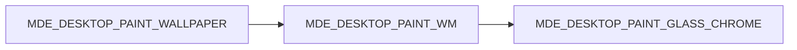

# LG-08 — Orquestación escritorio Liquid Glass

| Campo | Valor |
|-------|-------|
| Misión | LG-08 Desktop orchestration |
| Agente | `mde-desktop-architect` |
| Estado | COMPLETED |
| Ámbito | `mde/desktop/desktop.c`, `mde/include/mde.h`, este reporte |
| Modelo | Composer 2.5 |

## Objetivo

Orquestar el ciclo de vida del escritorio MDE para **Liquid Glass** por defecto (MDE Light): flag de look, estilos glass en chrome, orden de pintado para LG-03 y señal `mde_desktop_glass_enabled()` tras bring-up.

## Fuera de alcance (explícito)

- **Calendario** — sin componente ni API (reloj HH:MM solo en topbar shell).
- Código en `mde/compositor/` (LG-03 consume contratos aquí documentados).

## Archivos entregados

| Archivo | Rol |
|---------|-----|
| `mde/include/mde.h` | `MDE_DESKTOP_LOOK_LIQUID_GLASS`, paint stages, chrome glass, API |
| `mde/desktop/desktop.c` | Bootstrap glass, `mde_desktop_glass_enabled`, `metta_mde_bringup` |
| `docs/swarm/lg-08-report.md` | Contratos LG-03 |

## Look y tema

| Campo | Default |
|-------|---------|
| `theme_id` | `theme_get_default()` → `MDE_LIGHT` |
| `components` | `MDE_DESKTOP_DEFAULT_COMPONENTS` (topbar, dock, wallpaper) |
| `look` | `MDE_DESKTOP_LOOK_LIQUID_GLASS` |

`MDE_CONTRACT_REV` → **2**.

## Bootstrap `mde_init`

Orden interno (sin cambiar compositor):

1. Tema Light + `mde_chrome_apply()` (helpers glass en `controls.h`).
2. Layout (topbar alto `MDE_CTRL_GLASS_TOPBAR_HEIGHT` si glass).
3. Wallpaper (`wallpaper_load_default`).
4. `dock_init()` + `topbar_init()` — shell ya preparado para dibujo glass (LG-02+).

## Orden de pintado (contrato LG-03)

Back-to-front en cada dirty rect del compositor:



| Etapa | `mde_desktop_paint_stage_t` | Contenido |
|-------|-----------------------------|-----------|
| 0 | `MDE_DESKTOP_PAINT_WALLPAPER` | Blit `wallpaper_get_active()` o `palette->bg` |
| 1 | `MDE_DESKTOP_PAINT_WM` | Ventanas WM (opacas / glass window tokens) |
| 2 | `MDE_DESKTOP_PAINT_GLASS_CHROME` | Topbar + dock translúcidos (`comp_paint_chrome`) |

Iterar con `mde_desktop_paint_stage_at(i)` para `i ∈ [0, MDE_DESKTOP_PAINT_STAGE_COUNT)`.

El chrome glass debe ir **encima** del WM para que el dock/topbar refracten wallpaper y ventanas.

## API nueva / reforzada

```c
#define MDE_DESKTOP_LOOK_LIQUID_GLASS (1u << 0u)
#define MDE_DESKTOP_DEFAULT_LOOK      MDE_DESKTOP_LOOK_LIQUID_GLASS

bool mde_desktop_glass_enabled(void);           /* true en MDE_PHASE_READY + look glass */
const mde_desktop_chrome *mde_desktop_get_chrome(void);
const mde_glass_tokens *mde_desktop_glass_tokens(void);
mde_desktop_paint_stage_t mde_desktop_paint_stage_at(uint32_t index);

int metta_mde_bringup(uint32_t w, uint32_t h);  /* declarado en mde.h */
```

`mde_desktop_chrome` incluye `topbar_glass`, `dock_glass`, `window_glass`, `menu_glass` para leer blur/radius/borde sin hardcode en compositor.

## Bring-up kernel

`metta_mde_bringup` (tras FB ok):

1. `mde_init` → tema + shell + **READY**
2. `mde_desktop_on_ready()` (bootsplash SA-21)
3. `mde_frame_once()`
4. Compositor puede llamar `mde_desktop_glass_enabled()` de inmediato si rc == 0

## Integración LG-03 (compositor, pendiente en ese ámbito)

- Respetar `mde_desktop_paint_stage_at` al ordenar capas en `comp_scene_draw`.
- Si `mde_desktop_glass_enabled()`: usar `mde_desktop_glass_tokens()` y estilos en `mde_desktop_get_chrome()` para alpha/blur (`MDE_CTRL_GLASS_*_BLUR`).
- Insertar etapa WM entre wallpaper y `comp_paint_chrome` cuando WM esté enlazado.

## Criterios de aceptación

- [x] Flag `MDE_DESKTOP_LOOK_LIQUID_GLASS` y default en config
- [x] Bootstrap dock/topbar tras tema glass; sin calendario
- [x] `mde_desktop_glass_enabled()` tras `metta_mde_bringup` ok
- [x] Orden paint documentado: wallpaper → wm → glass chrome
- [x] Tema default MDE Light + chrome glass
- [x] Contratos LG-03 sin editar `compositor/`