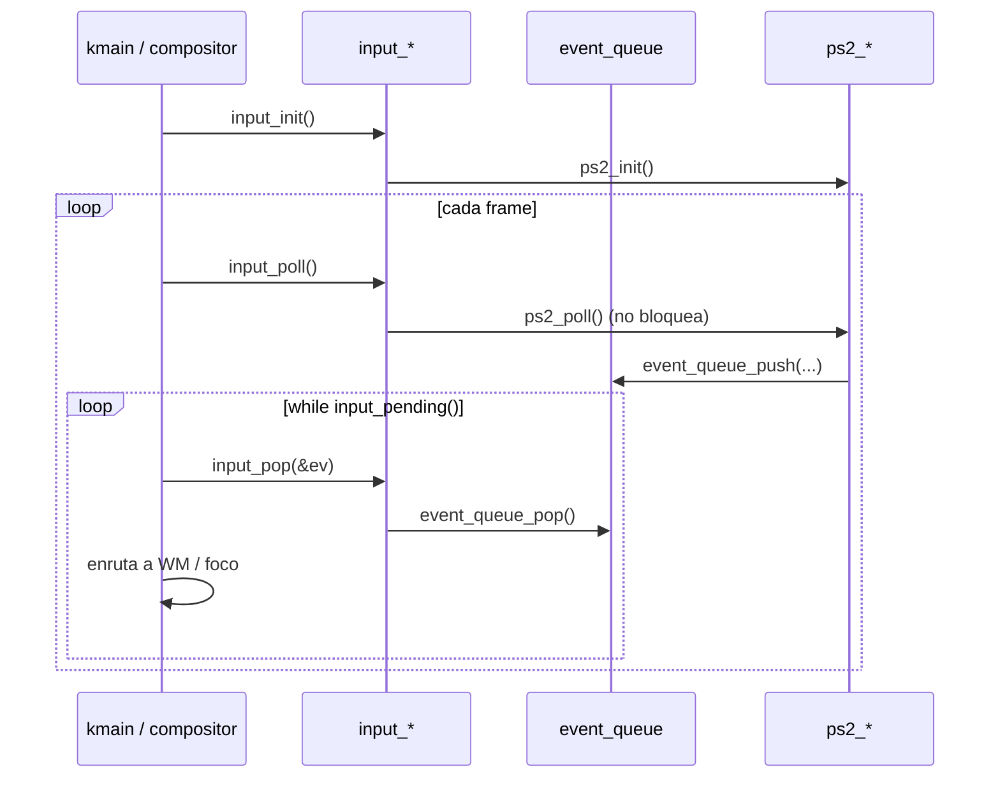

# SA-13 — Input driver (PS/2 + cola de eventos)

**Agente:** input-driver-engineer  
**Estado:** COMPLETED  
**Archivos:** `kernel/drivers/input/ps2.c`, `kernel/drivers/input/event_queue.c`, `kernel/include/input/*.h`

## Objetivo

Exponer entrada teclado/ratón PS/2 al escritorio MDE mediante **polling no bloqueante**, una cola circular acotada y el tipo unificado `input_event_t`.

## API implementada

| Símbolo | Rol |
|---------|-----|
| `input_event_t` | Evento de tecla, movimiento o botón |
| `input_init` | Resetea cola e inicializa PS/2 |
| `input_poll` | Vacía el buffer del controlador (≤64 bytes/frame) |
| `input_pop` | El compositor consume un evento |
| `input_pending` | Profundidad actual de la cola |
| `event_queue_*` | Cola interna (también usable en tests kernel) |
| `ps2_*` | Inicialización y drenado del hardware |

## Contrato Input ↔ MDE (SA-15+)



### Reglas para el compositor

1. **Inicialización:** llamar `input_init()` tras IRQ/PIC listos (SA-06); no consumir eventos antes.
2. **Por frame:** exactamente una `input_poll()` al inicio del ciclo de composición; luego drenar con `input_pop` hasta vaciar o límite de presupuesto.
3. **No bloquear:** `input_poll` y `input_pop` son O(1); nunca esperan E/S ni sleep.
4. **Desbordamiento:** cola `INPUT_QUEUE_CAPACITY` (128); `event_queue_push` falla con `-2` y el evento se pierde (futuro: contador de drops).
5. **Coordenadas ratón:** `u.mouse.x/y` son acumuladas desde el arranque; `dx/dy` son delta del último paquete.
6. **Modificadores:** bitmask `input_modifier_t` en eventos de tecla.
7. **IRQ:** esta fase usa solo **polling**; IRQ 1/12 podrá registrarse en SA-06+ sin cambiar la API pública.

### Tipo compartido

```c
typedef struct {
    input_event_type_t type;
    uint64_t           time_ms;
    union { /* key | mouse | btn */ } u;
} input_event_t;
```

Teclado: scancode set **1** (make 0x00–0x7F, break con bit 0x80; prefijo `0xE0` para teclas extendidas).  
Ratón: paquetes de 3 bytes en modo stream; botones izquierdo/centro/derecho.

## Integración build (SA-03)

El `Makefile` ya incluye `kernel/*/*/*.c`. Fuentes nuevas:

- `kernel/drivers/input/ps2.c`
- `kernel/drivers/input/event_queue.c`
- Include path: `-I kernel/include`

`kmain` / shell MDE: `input_init();` y en el bucle de frame `input_poll()` + `input_pop`.

## Pruebas sugeridas (SA-35)

1. QEMU `-m 4096`: tras `input_init`, pulsar tecla → `input_pending() > 0` y `INPUT_EV_KEY_DOWN`.
2. Movimiento ratón → `INPUT_EV_MOUSE_MOVE` con `dx/dy` no nulos.
3. Saturar cola (>128 eventos sin `input_pop`) → push retorna `-2` sin colgar el kernel.

## Fuera de alcance (esta misión)

- Window manager, grab de foco, atajos globales (SA-15/16).
- USB HID, multitouch, gamepads.
- Input en espacio de usuario / syscall `read` sobre `/dev/input`.

## Dependencias

| De | Para |
|----|------|
| SA-06 IRQ/PIT | `pit_ticks_get` para `time_ms`; PIC antes de `ps2_init` en hardware real |
| SA-15 Compositor | Consumidor principal de `input_poll` / `input_pop` |

## Errores / limitaciones

- Mapa scancode→`input_keycode_t` parcial (QWERTY US); teclas desconocidas se descartan.
- Sin bloqueo IRQ: latencia = periodo de poll del compositor.
- Ratón sin rueda en paquete de 3 bytes (evento `INPUT_EV_MOUSE_WHEEL` reservado para protocolo 4 bytes).