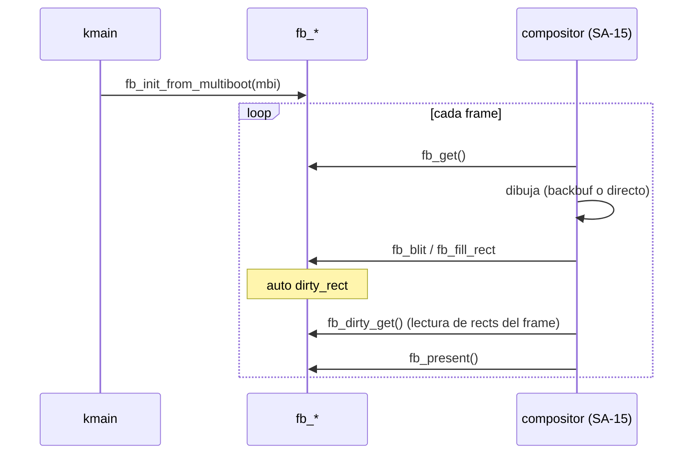

# SA-14 — Framebuffer Engine

**Agente:** framebuffer-engineer  
**Estado:** COMPLETED  
**Archivos:** `kernel/graphics/fb.c`, `kernel/include/graphics/fb.h`

## Objetivo

API de framebuffer lineal a partir del tag Multiboot2 tipo **8** (framebuffer), con primitivas de dibujo y seguimiento de **dirty rectangles** para el compositor MDE (SA-15).

## API implementada

| Símbolo | Rol |
|---------|-----|
| `framebuffer_t` | Estado del FB (base, dimensiones, pitch, formato) |
| `fb_init_from_multiboot` | Recorre tags MB2 y aplica tag 8 |
| `fb_fill_rect` | Relleno sólido XRGB8888 |
| `fb_blit` | Copia buffer CPU → FB con stride |
| `fb_mark_dirty*` | Registra regiones sucias |
| `fb_present` | Fin de frame; fusiona rects y limpia lista |
| `fb_get` / `fb_dirty_get` | Lectura para compositor |

## Multiboot2 (tag 8)

- Constante: `FB_MULTIBOOT_TAG_FRAMEBUFFER` (8).
- Parser en `fb_find_framebuffer_tag()` (interno a `fb.c`).
- Soportado en esta fase: `framebuffer_type == RGB`, `bpp == 32` → `FB_FORMAT_XRGB8888`.
- Otros bpp: `fb_init_from_multiboot` retorna `-3` (extensión futura).

### Mapeo físico

Por defecto se asume **mapa identidad** (`phys` → `(void *)phys`).  
VMM (SA-09) puede registrar:

```c
fb_set_phys_mapper(my_map_framebuffer_phys);
```

antes de `fb_init_from_multiboot`.

## Contrato Framebuffer ↔ Compositor (SA-15)



### Reglas para el compositor

1. **Inicialización:** no dibujar hasta `fb_get() != NULL` y `ready == 1`.
2. **Formato de color:** `0x00RRGGBB` (byte alto ignorado en hardware XRGB).
3. **Coordenadas:** origen arriba-izquierda; recorte automático en `fb_fill_rect` / `fb_blit`.
4. **Dirty rects:**
   - Las primitivas FB marcan sucio el rectángulo **recortado**.
   - El compositor puede llamar `fb_mark_dirty_rect` si modifica vía otro camino.
   - Máximo `FB_MAX_DIRTY_RECTS` (32); al saturar → `full_frame = 1`.
5. **Fin de frame:** leer `fb_dirty_get()` si el compositor optimiza por rect; luego `fb_present()` una vez (fusiona y reinicia dirty para el siguiente frame).
6. **Doble buffer:** no incluido en SA-14; flags/doble buffer viven en SA-15. Este FB es **front buffer lineal** expuesto por GRUB/QEMU.

### Tipos compartidos

```c
typedef struct {
    int32_t x, y, w, h;
} fb_rect_t;

typedef struct {
    fb_rect_t rects[FB_MAX_DIRTY_RECTS];
    uint32_t  count;
    int       full_frame;
} fb_dirty_t;
```

El compositor **no** debe escribir en `g_fb.base` sin pasar por la API (permite futura instrumentación y VMM).

## Integración build (SA-03)

Añadir a las fuentes del kernel:

- `kernel/graphics/fb.c`
- Include path: `-I kernel/include`

## Pruebas sugeridas (SA-35)

1. QEMU con video multiboot framebuffer: `fb_init_from_multiboot` retorna 0.
2. `fb_fill_rect(0,0,64,64, fb_rgb(0xF6,0xF8,0xFB))` visible en esquina.
3. Tras blit + `fb_present`, `fb_dirty_get()->count == 0` (lista consumida).

## Fuera de alcance (esta misión)

- Compositor MDE, topbar, dock (SA-15+).
- Indexed / EGA text mode.
- Aceleración por dirty blit a hardware.