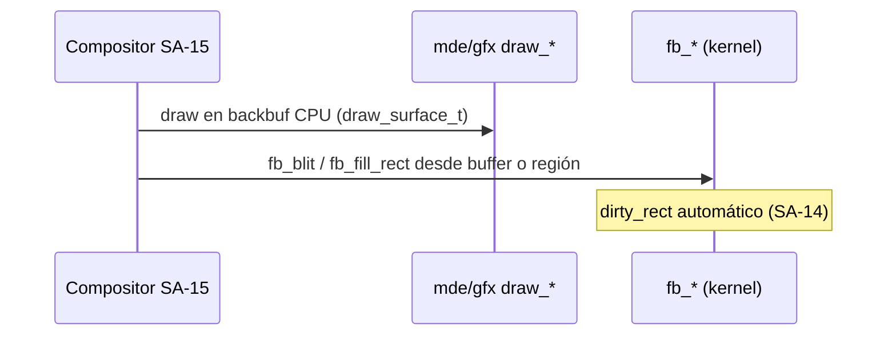

# SA-16 — Primitivas 2D y fuente bitmap MDE

**Agente:** rasterization-typography-engineer  
**Estado:** COMPLETED  
**Ámbito:** `mde/gfx/` (sin cambios en kernel)

## Objetivo

Capa de rasterización CPU para el escritorio MDE: dibujo en buffers lineales `XRGB8888`, fuente monospace 8×8 legible en tema claro, y caché de glifos para etiquetas repetidas (topbar, dock, apps nativas).

## Archivos entregados

| Archivo | Rol |
|---------|-----|
| `mde/gfx/draw.h` / `draw.c` | Superficie, clip, relleno, trazos, líneas, rectángulos redondeados, blit |
| `mde/gfx/font.h` / `font.c` | Fuente VGA 8×8 (ASCII `0x20`–`0x7E`), métricas y texto |
| `mde/gfx/glyph_cache.h` / `glyph_cache.c` | Caché LRU (64 entradas) de glifos rasterizados |

## Contrato de color y coordenadas

- **Color en superficie:** `0x00RRGGBB` (mismo convenio que `fb_rgb`, SA-14).
- **Tema MDE:** `draw_color_from_theme()` recorta `0xFFRRGGBB` → `0x00RRGGBB` (SA-18).
- **Origen:** esquina superior izquierda; ejes X→derecha, Y→abajo.
- **Clip:** opcional por superficie (`draw_set_clip_rect`); todas las primitivas respetan intersección clip ∩ superficie.

## API principal (`draw`)

```c
void draw_surface_init(draw_surface_t *s, uint32_t *pixels,
                       int32_t w, int32_t h, int32_t stride);
void draw_fill_rect(draw_surface_t *s, int32_t x, int32_t y, int32_t w, int32_t h, uint32_t color);
void draw_fill_rounded_rect(draw_surface_t *s, int32_t x, int32_t y, int32_t w, int32_t h,
                            int32_t radius, uint32_t color);
void draw_stroke_rounded_rect(...);  /* chrome MDE; esquinas facetadas */
void draw_blit(draw_surface_t *dst, int32_t dx, int32_t dy,
               const uint32_t *src, int32_t sw, int32_t sh, int32_t src_stride);
```

Rectángulos redondeados alineados con `MDE_CTRL_*_RADIUS` en `mde/theme/controls.h` (6 px botones, 10 px ventanas).

## Fuente bitmap

| Constante | Valor |
|-----------|-------|
| Celda | 8×8 px |
| Avance | 8 px |
| Rango | U+0020 … U+007E (95 glifos) |
| Origen datos | `font8x8_basic` (dominio público, VGA) embebido en `font.c` |

```c
void font_draw_string(draw_surface_t *dst, int32_t x, int32_t y, const char *text,
                      uint32_t fg, uint32_t bg, int transparent_bg);
int32_t font_string_advance(const char *text);
```

- Sin emojis ni conjuntos Unicode extendidos (fase mínima).
- Fuera de rango → glifo `?`.
- Texto recomendado: `MDE_LIGHT_TEXT` / `MDE_LIGHT_MUTED` sobre `surface` o `secondary` (SA-18).

## Caché de glifos

- 64 ranuras; clave `(ch, fg, bg, transparent_bg)`.
- `glyph_cache_draw_string()` acelera UI con cadenas estáticas (p. ej. «MettaOS», etiquetas del dock).
- Estadísticas opcionales: `glyph_cache_hits()` / `glyph_cache_misses()`.

## Relación Framebuffer ↔ MDE (SA-14 / SA-15)



El compositor puede:

1. Pintar en buffer CPU con `mde/gfx` (recomendado para ventanas).
2. Volcar a framebuffer físico vía `fb_blit` conservando formato `0x00RRGGBB`.

## Integración build (pendiente SA-03)

Añadir al makefile del kernel o librería MDE:

```makefile
MDE_GFX_SRCS := mde/gfx/draw.c mde/gfx/font.c mde/gfx/glyph_cache.c
CFLAGS += -I$(ROOT)/mde/gfx
```

Compilación de verificación sugerida (WSL / Linux):

```bash
gcc -std=c11 -Wall -Wextra -Wpedantic -c mde/gfx/draw.c
gcc -std=c11 -Wall -Wextra -Wpedantic -c mde/gfx/font.c
gcc -std=c11 -Wall -Wextra -Wpedantic -c mde/gfx/glyph_cache.c
```

## Pruebas sugeridas (SA-35)

1. Buffer 64×32: `draw_fill_rounded_rect` radio 6 con `draw_color_from_theme(MDE_LIGHT_SURFACE)`.
2. Cadena `"MettaOS 01"` con `font_draw_string` y fg `MDE_LIGHT_TEXT`.
3. Repetir (2) con `glyph_cache_draw_string`; verificar `glyph_cache_misses()` baja en segunda pasada.
4. Blit del buffer a FB vía `fb_blit`; comprobar dirty rect en SA-14.

## Fuera de alcance

- FreeType, subpixel, kerning, Unicode > Latin-1.
- Anti-aliasing vectorial (AA) en primitivas; solo font bitmap crisp.
- Acceleración GPU / SIMD.
- Enlace directo a `fb_*` desde `mde/gfx` (permanece en compositor).

## Criterios de aceptación

- [x] Primitivas 2D mínimas en `draw.c`
- [x] Fuente bitmap 8×8 ASCII en `font.c`
- [x] Caché de glifos en `glyph_cache.c`
- [x] Solo directorio `mde/gfx/` + reporte
- [x] Colores compatibles MDE Light y framebuffer SA-14