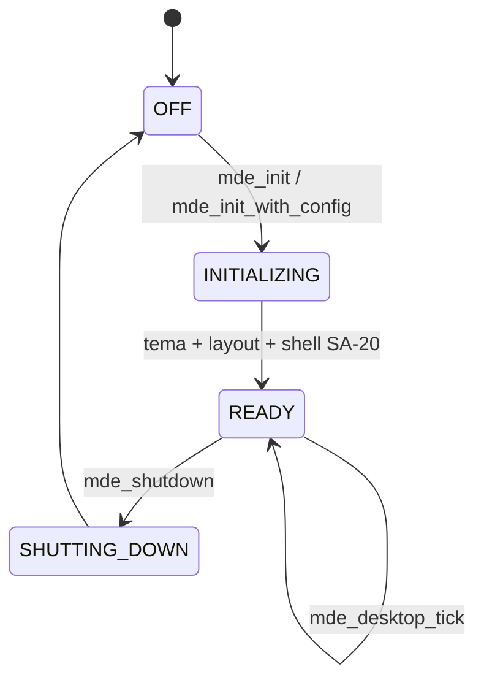

# SA-17 — Ciclo de vida del escritorio MDE

| Campo | Valor |
|-------|-------|
| Misión | SA-17 Desktop lifecycle |
| Agente | mde-desktop-architect |
| Estado | COMPLETED |
| Ámbito | `mde/desktop/`, `mde/include/` |

## Objetivo

Definir el **ciclo de vida** del Metta Desktop Environment: inicio, frame tick, apagado y layout del chrome (topbar, dock, área de trabajo, wallpaper), con colores resueltos **solo** por la API de tema SA-18.

## Fuera de alcance (explícito)

- **Calendario** — no hay componente ni máscara `MDE_COMPONENT_CALENDAR`.
- Compositor, pintado framebuffer, window manager (SA-15+).
- Calendario (reiterado en bringup kmain).

## Archivos entregados

| Archivo | Rol |
|---------|-----|
| `mde/include/mde.h` | API pública: fases, config, layout, tema, tick |
| `mde/desktop/desktop.c` | Estado global, init/shutdown, `metta_mde_bringup`, `mde_frame_once` |
| `kernel/kernel.c` | Invoca `metta_mde_bringup` tras FB ok (stub débil opcional) |

## Ciclo de vida



| Fase | Descripción |
|------|-------------|
| `MDE_PHASE_OFF` | Sin escritorio |
| `MDE_PHASE_INITIALIZING` | Tema SA-18, geometría, wallpaper, **dock/topbar** |
| `MDE_PHASE_READY` | Compositor puede tick; dock con 3 ítems listo |
| `MDE_PHASE_SHUTTING_DOWN` | Descarga wallpaper y resetea estado |

## Componentes (máscara)

| Bit | `mde_desktop_component_t` | Predeterminado |
|-----|---------------------------|----------------|
| 0 | `MDE_COMPONENT_TOPBAR` | on |
| 1 | `MDE_COMPONENT_DOCK` | on |
| 2 | `MDE_COMPONENT_WALLPAPER` | on |

Predeterminado: `MDE_DESKTOP_DEFAULT_COMPONENTS` (los tres). **Sin calendario.**

## Integración tema (SA-18)

- `theme_get_default()` en config por defecto → `MDE_LIGHT`.
- `theme_get` / `theme_palette` alinear chrome (`mde_bar_style`, `mde_window_style`).
- `mde_desktop_background_color()` expone `palette->bg` (escritorio `#F6F8FB` en Light).
- Sin literales `0xRRGGBB` en `desktop.c`.

## API resumida

```c
int mde_init(uint32_t screen_width, uint32_t screen_height);
int mde_init_with_config(uint32_t w, uint32_t h, const mde_desktop_config *cfg);
void mde_shutdown(void);
int mde_desktop_tick(void);
const mde_palette *mde_desktop_palette(void);
const mde_desktop_layout *mde_desktop_get_layout(void);
void mde_desktop_on_ready(void);  /* contrato bootsplash SA-21 */
```

## Layout

- Topbar: alto `MDE_CTRL_BAR_HEIGHT` (28 px), ancho pantalla.
- Dock: centrado inferior, margen `MDE_CTRL_DOCK_MARGIN_BOTTOM`, altura chrome + padding.
- `work_area`: pantalla menos topbar e inserción inferior del dock.

## Shell chrome (SA-20) en `mde_init`

Tras layout y wallpaper, `mde_shell_chrome_bootstrap()`:

| Componente ON | Llamadas |
|---------------|----------|
| `MDE_COMPONENT_DOCK` | `dock_init()` → registra **Notes**, **Files**, **Terminal** (`mde.notes` / `mde.files` / `mde.terminal`); `dock_set_viewport(w, h)` |
| `MDE_COMPONENT_TOPBAR` | `topbar_init()` si enlaza (`__attribute__((weak))` en `desktop.c`); `topbar_set_viewport(w)` |

Sin calendario: el dock solo expone las tres apps; la topbar usa reloj HH:MM (SA-20).

**Precondición SA-15:** `compositor_frame_tick(c, now_ms)` asume que **`mde_init` ya ejecutó** `dock_init()` (lista de ítems y estilo MDE Light). Puede volver a llamar `dock_init()` en `compositor_shell_bootstrap`, pero el tick de frame **no** registra ítems por sí mismo: depende del escritorio listo en fase `MDE_PHASE_READY` con `dock_item_count() >= 1` (por defecto 3).

## Dependencias externas (solo enlace)

| Símbolo | Origen |
|---------|--------|
| `theme_*` | `mde/theme/theme.c` |
| `wallpaper_*` | `mde/shell/wallpaper.c` (SA-21) |
| `dock_*` | `mde/shell/dock.c` (SA-20) |
| `topbar_*` | `mde/shell/topbar.c` (SA-20, opcional débil) |

## Pruebas sugeridas

```bash
gcc -std=c11 -Wall -Wextra \
  -Imde/include -Imde/theme -I. \
  -c mde/theme/light.c -c mde/theme/theme.c \
  -c mde/shell/dock.c -c mde/shell/topbar.c \
  -c mde/shell/wallpaper.c -c mde/desktop/desktop.c
```

Verificación lógica: tras `mde_init(1280, 720)` → `mde_get_phase() == MDE_PHASE_READY`, `mde_desktop_palette()->bg == theme_palette(MDE_LIGHT)->bg`.

## Criterios de aceptación

- [x] `mde.h` + `desktop.c` con ciclo init / tick / shutdown
- [x] Tema vía `theme_get` / `theme_palette` (SA-18)
- [x] Sin calendario ni referencias en API
- [x] Colores del chrome derivados de paleta, no hardcode en desktop
- [x] Informe SA-17 en `docs/swarm/`

## kmain (cableado mínimo SA-12 + SA-17)

Orden en `kernel/kernel.c` tras `fb_init_from_multiboot` con éxito y dimensiones válidas en `metta_boot_info_t`:

1. `fb_init_from_multiboot(mbi)` (SA-12 / SA-14).
2. `metta_mde_bringup(info->fb_width, info->fb_height)` — export en `mde/desktop/desktop.c`.

`metta_mde_bringup` ejecuta:

- `mde_init(w, h)` con tema SA-18, `dock_init()` / `topbar_init()` y componentes por defecto (sin calendario).
- `mde_desktop_on_ready()` (contrato bootsplash SA-21).
- `mde_frame_once()` → stub que llama `mde_desktop_tick()` (draw FB pendiente SA-15).

Enlace:

| Símbolo | Ubicación | Nota |
|---------|-----------|------|
| `metta_mde_bringup` | `mde/desktop/desktop.c` | fuerte si MDE en link |
| stub débil | `kernel/kernel.c` | `return -1` si no hay MDE |

Log: `mde bring-up ok` o `metta_mde_bringup rc=%d` vía KLOG.

## Próximos pasos

1. SA-15: compositor pinta con `mde_desktop_get_layout()` y paleta.
2. Rellenar `mde_frame_once()` con clear/blit escritorio (`fb_fill_rect` con `mde_desktop_background_color()`).
3. Bootsplash: enganchar retención 2 s tras `mde_desktop_on_ready()`.