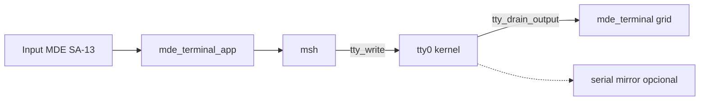

# SA-28 — Terminal gráfica, TTY y Metta Shell (msh)

| Campo | Valor |
|-------|-------|
| Misión | SA-28 Terminal & Shell Engineer |
| Agente | terminal-shell-engineer |
| Estado | COMPLETED (fase contrato + stubs ejecutables) |
| Fecha | 2026-11-22 |

## Objetivo

Implementar la infraestructura de **TTY en kernel**, la **terminal gráfica MDE** y el **shell inicial nativo Metta Shell (msh)**. Preparar el camino hacia POSIX sin confundir componentes con software GNU.

## Política de nomenclatura (obligatoria)

| Componente | Nombre correcto | Incorrecto |
|------------|-----------------|------------|
| Shell inicial MettaOS | **Metta Shell (`msh`)** | «shell casero» genérico |
| GNU Bash (futuro SA-32) | **GNU Bash** (upstream GNU) | «shell casero», «nuestro Bash» |
| Terminal gráfica | **MDE Terminal** | Emulador xterm genérico |

**GNU Bash no es un shell casero de MettaOS.** Cuando exista compatibilidad Linux, Bash se integrará como binario/interprete **GNU** distinto de `msh`. La documentación y los mensajes de `msh` mantienen esa separación.

## Entregables

| Ruta | Rol |
|------|-----|
| `kernel/include/tty/tty.h` | API TTY: anillos entrada/salida, `tty_default()`, drenaje |
| `kernel/tty/tty.c` | Implementación kernel (eco opcional a UART) |
| `mde/apps/terminal/terminal.h` | Cuadrícula de celdas 80×24, colores MDE Light |
| `mde/apps/terminal/terminal.c` | Parser mínimo (`\n`, `\r`, `\t`, `\b`), sync TTY |
| `mde/apps/terminal/msh.h`, `msh.c` | Intérprete de línea **msh** (`help`, `echo`, `clear`, `uname`, `exit`) |
| `mde/apps/terminal/terminal_app.h`, `terminal_app.c` | Ensamble tty0 + vista + sesión msh |

## Contrato TTY ↔ Terminal ↔ msh



### API TTY (kernel)

```c
void tty_init(void);
tty_device_t *tty_default(void);
size_t tty_write(tty_device_t *tty, const char *buf, size_t len);
size_t tty_read(tty_device_t *tty, char *buf, size_t max_len);
void tty_input_byte(tty_device_t *tty, uint8_t byte);
size_t tty_drain_output(tty_device_t *tty, char *buf, size_t max_len);
void tty_set_serial_mirror(int enable);
```

- `tty0` activo por defecto (`TTY_VT_DEFAULT`).
- Anillos: entrada 2 KiB, salida 8 KiB.
- `tty_set_serial_mirror(0)` en la app Terminal para no duplicar eco en COM1 cuando el escritorio pinta la vista.

### API terminal gráfica

```c
int  mde_terminal_create(mde_terminal_t *term, uint16_t cols, uint16_t rows);
void mde_terminal_attach_tty(mde_terminal_t *term, tty_device_t *tty);
void mde_terminal_sync_from_tty(mde_terminal_t *term);
void mde_terminal_key_char(mde_terminal_t *term, char c); /* teclado directo sin msh */
```

Ventana de app: `mde_terminal_app_start()` + `mde_terminal_app_key(c)` + `mde_terminal_app_view()`.

### Metta Shell (msh)

- Prompt: `metta$ `
- Versión: `0.1.0-sa28`
- Sin fork/exec (depende SA-09/SA-10); comandos intrínsecos únicamente.

## Fuera de alcance (esta misión)

- Enlace en Makefile kernel/MDE (SA-03 / SA-17).
- PTY, job control, señales, `ioctl` POSIX (SA-32).
- Pintado de glifos en framebuffer (SA-16 + compositor SA-15).
- Integración teclado PS/2 (SA-13).
- Ejecución de **GNU Bash** o cualquier intérprete Linux.

## Dependencias

| SA | Necesidad |
|----|-----------|
| SA-03 | Compilar `kernel/tty/tty.c` en `mettaos.bin` |
| SA-06 | `serial.c` para mirror opcional |
| SA-13 | Teclado → `mde_terminal_app_key` |
| SA-15/16 | Rasterizar `mde_term_cell_t` en ventana |
| SA-17/19 | Ciclo de vida app `.mettaapp` Terminal |
| SA-32 | Runtime Linux; **GNU Bash aparte de msh** |

## Pruebas ejecutadas

**2026-11-22 — WSL:** `gcc` no está en PATH (`command not found`). Infraestructura pendiente de `scripts/wsl-setup.sh` (misma situación que SA-35). Comando previsto:

```bash
INC="-Ikernel/include -Imde/apps/terminal"
KFLAGS="-std=gnu11 -ffreestanding -fno-stack-protector -mno-red-zone -mcmodel=kernel -Wall -Wextra -c"
gcc $KFLAGS $INC -o /tmp/tty.o kernel/tty/tty.c
gcc $KFLAGS $INC -o /tmp/term.o mde/apps/terminal/terminal.c
gcc -std=gnu11 -Wall -Wextra $INC -c -o /tmp/msh.o mde/apps/terminal/msh.c
```

(`terminal_app.c` requiere enlazar `tty.o` + `serial.o`; integración SA-03.)

## Próximos pasos

1. Registrar app Terminal en el launcher MDE con icono (assets SA-21).
2. Cablear SA-13: teclas → `mde_terminal_app_key`.
3. Pintar celdas con fuente monoespaciada (SA-16) y dirty rects (SA-15).
4. Añadir syscalls `read`/`write` sobre fd de TTY cuando exista VFS (SA-23) y procesos (SA-09).

## Riesgos

| Riesgo | Mitigación |
|--------|------------|
| Confundir msh con Bash en docs/UX | Mensajes explícitos en `msh` y este informe |
| Buffer estático único en `terminal.c` | Sustituir por allocator MDE en SA-17 |
| Eco doble (UART + GUI) | `tty_set_serial_mirror(0)` en app gráfica |