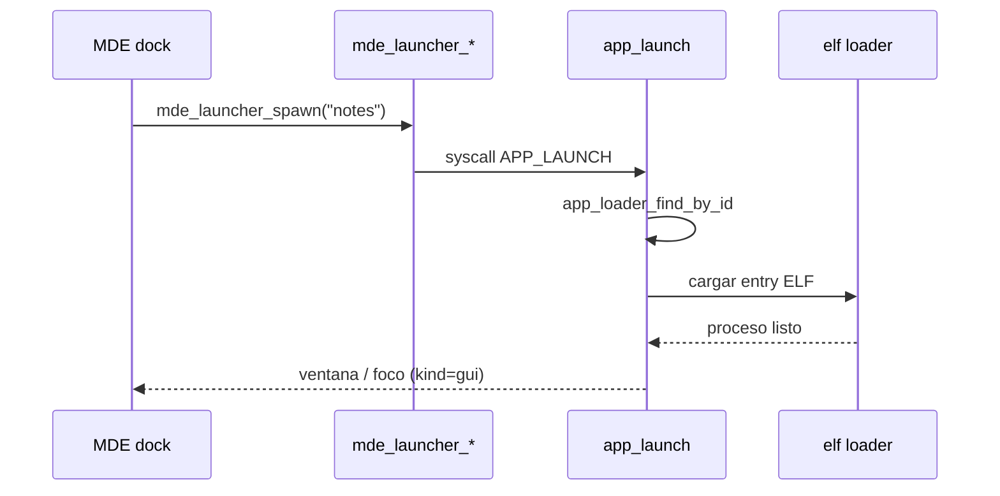

# SA-29 — Native Applications & Launcher (informe)

| Campo | Valor |
|-------|-------|
| Misión | SA-29 ABI apps `.mettaapp` y launcher |
| Agente | native-applications-engineer |
| Estado | COMPLETED (parseo + registro stub; sin ELF/VFS) |
| Fecha | 2026-11-22 |

## Entregables

| Archivo | Descripción |
|---------|-------------|
| `kernel/apps/loader.c` | Parseo/validación de manifiestos, registro en kernel, `app_launch` stub |
| `mde/apps/launcher.c` | Lista de apps para MDE, parseo compatible, `mde_launcher_spawn` stub |
| `docs/swarm/sa-29-report.md` | Este informe + especificación del formato |

## Fuera de alcance (explícito)

- Headers públicos (`kernel/include/metta/app_loader.h`, `mde/apps/launcher.h`).
- Carga ELF64 real (`kernel/loader/elf.c` — SA-23).
- Syscall `METTA_SYS_APP_LAUNCH` (SA-33).
- Escaneo de directorios vía VFS/MFS (SA-24/25/26).
- Iconos en dock, ventana del launcher y animaciones MDE (SA-15+).
- Integración Makefile para `mde/apps/*.c` (hoy solo kernel en `make all`).

## Formato manifiesto `.mettaapp` (rev 1)

Archivo de texto **UTF-8**, líneas terminadas en `\n`.

### Reglas

1. **Primera línea no vacía y no comentario:** `mettaapp/1` (contrato rev 1).
2. Resto: pares `clave=valor`, una por línea.
3. Líneas que empiezan por `#` son comentarios.
4. Claves desconocidas se **ignoran** (compatibilidad hacia adelante).
5. Rutas `entry` e `icon` son **relativas** al directorio del paquete; sin `..`, sin ruta absoluta.

### Claves

| Clave | Obligatoria | Valores / notas |
|-------|-------------|-----------------|
| `id` | sí | `[a-z0-9._-]+`, máx. 63 chars |
| `name` | sí | Nombre visible en MDE |
| `version` | sí | Cadena libre (semver recomendado) |
| `entry` | sí | Ruta relativa al binario ELF de la app |
| `kind` | sí | `gui` \| `cli` \| `service` |
| `icon` | no | Ruta relativa a recurso PNG (MDE Light) |

### Ejemplo canónico

```text
mettaapp/1
id=notes
name=Notes
version=0.1.0
entry=bin/notes.elf
icon=icons/notes.png
kind=gui
```

### Layout de paquete sugerido

```text
/opt/metta/apps/notes/
  manifest.mettaapp   # o notes.mettaapp — mismo contenido
  bin/notes.elf
  icons/notes.png
```

El nombre de archivo `.mettaapp` es convención; el parser opera sobre el **contenido**, no sobre la extensión.

## API kernel (`loader.c`)

| Símbolo | Rol |
|---------|-----|
| `app_loader_init` | Inicializa registro; registra manifiesto ejemplo `notes` |
| `app_loader_shutdown` | Limpia registro |
| `app_manifest_parse` | Parsea buffer con longitud explícita |
| `app_manifest_parse_buffer` | Atajo con `strlen` |
| `app_loader_count` / `app_loader_get` | Iteración del registro |
| `app_loader_register_manifest` | Alta manual (post-VFS) |
| `app_loader_find_by_id` | Búsqueda por `id` |
| `app_launch` | Stub: `METTA_ERR_BUSY` si el id existe (sin proceso aún) |

## API MDE (`launcher.c`)

| Símbolo | Rol |
|---------|-----|
| `mde_launcher_init` | Apps integradas `notes` + `files` (manifiestos embebidos) |
| `mde_launcher_shutdown` | Limpia estado |
| `mde_launcher_parse_manifest` | Mismo formato que kernel (código duplicado a propósito en SA-29) |
| `mde_launcher_entry_count` / `mde_launcher_get_entry` | Lista para dock |
| `mde_launcher_find` | Resolución por `id` |
| `mde_launcher_spawn` | Stub: `0` si existe id, sin syscall |
| `mde_launcher_ingest_manifest_text` | Alta dinámica (futuro escaneo VFS) |

## Flujo objetivo (integración futura)



## Verificación sugerida

1. Compilar solo `loader.c` con flags del Makefile:  
   `gcc -std=gnu11 -ffreestanding -Ikernel/include -c kernel/apps/loader.c`
2. Test harness mínimo (fuera de esta misión): parsear manifiesto válido/ inválido y comprobar códigos `metta_status_t`.
3. Tras SA-33: `app_launch` debe dejar de retornar `METTA_ERR_BUSY` y crear proceso.

## Riesgos / dependencias

| Dependencia | Nota |
|-------------|------|
| SA-23 ELF loader | Requerido para ejecutar `entry` |
| SA-09 scheduler | Proceso hijo y cambio de contexto |
| SA-24 VFS | Descubrimiento de `.mettaapp` en disco |
| SA-33 syscalls | Puente MDE ↔ kernel |
| SA-15 compositor | Ventanas para `kind=gui` |

## Próximos pasos

1. Extraer parser común a `kernel/include/metta/mettaapp.h` compartido con MDE (unificar con SA-33).
2. Implementar escaneo `vfs_readdir` en `app_loader_scan_path`.
3. Conectar dock MDE Light con iconos SA-21/SA-26/SA-27.