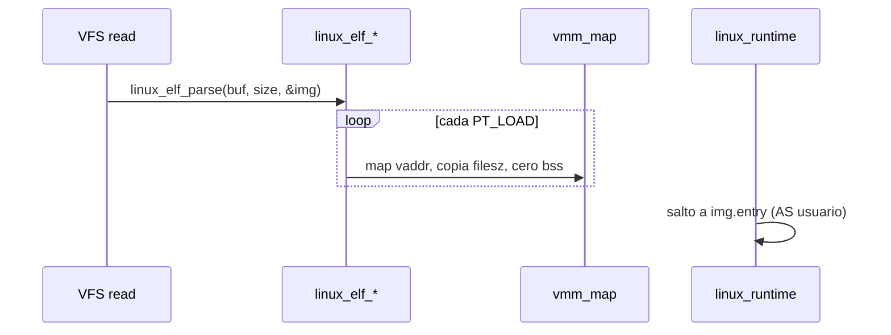

# SA-30 — ELF64 Loader (validación + PT_LOAD)

| Campo | Valor |
|-------|-------|
| Misión | SA-30 ELF64 loader |
| Agente | elf-loader-engineer |
| Estado | COMPLETED (parser/validación; sin mapeo VMM) |
| Fecha | 2026-11-22 |

## Objetivo

Validar binarios **ELF64** little-endian **x86-64** (`ET_EXEC` / `ET_DYN`) y exponer segmentos **PT_LOAD** ordenados para la capa de ejecución Linux (SA-31/32) y `execve` futuro.

## Archivos (ámbito `kernel/linux/elf*`)

| Archivo | Rol |
|---------|-----|
| `kernel/linux/elf_types.h` | Layout `Elf64_Ehdr` / `Elf64_Phdr`, constantes `PT_*`, `PF_*`, `ET_*` |
| `kernel/linux/elf.h` | API pública `linux_elf_*`, `linux_elf_image_t` |
| `kernel/linux/elf.c` | Validación y recorrido de program headers |

## API

```c
#define METTA_LINUX_ELF_REV 1
#define METTA_LINUX_ELF_MAX_PT_LOAD 16

typedef struct { ... } linux_elf_pt_load_t;
typedef struct { ... } linux_elf_image_t;

metta_status_t linux_elf_validate(const void *image, metta_u64 size);
metta_status_t linux_elf_parse(const void *image, metta_u64 size,
                               linux_elf_image_t *out);
metta_status_t linux_elf_pt_load_get(const linux_elf_image_t *img, metta_u32 index,
                                     linux_elf_pt_load_t *seg);
metta_status_t linux_elf_vaddr_in_exec_load(const linux_elf_image_t *img,
                                            metta_u64 vaddr);
```

## Reglas de validación

1. **Ident:** magia `\\x7fELF`, clase 64, endian LE, versión ELF 1.
2. **Cabecera:** `e_machine == EM_X86_64`, `e_type ∈ {ET_EXEC, ET_DYN}`, tamaños de ehdr/phdr correctos, tabla de programa dentro del buffer.
3. **PT_LOAD:** `p_memsz ≥ p_filesz`, `p_offset + p_filesz` dentro del archivo, flags ⊆ `PF_R|PF_W|PF_X`, al menos `PF_R` o `PF_X`, congruencia `p_vaddr ≡ p_offset (mod p_align)` si `p_align > 1`.
4. **Cobertura:** al menos un PT_LOAD; `e_entry` en rango de un segmento con **PF_X** (PIE vía `ET_DYN` → `linux_elf_image_t.pie = 1`).
5. **Solapamiento VA:** segmentos LOAD que se solapan con distintas `p_flags` → `METTA_ERR_CORRUPT`.
6. **PT_INTERP:** solo marca `has_interp`; no se carga intérprete en esta fase.
7. **PT_GNU_STACK:** rechaza stack ejecutable (`PF_X`).

## Flujo hacia ejecución (futuro)



## Compilación

`elf.c` se incluye vía wildcard del `Makefile` (`kernel/*/*.c`). Los `#include "elf.h"` resuelven por directorio del fuente. Consumidores externos pueden añadir `-I$(ROOT)/kernel/linux` o incluir con ruta relativa hasta exista `kernel/include/linux/elf.h` (fuera de alcance SA-30).

```bash
gcc -std=gnu11 -ffreestanding -fno-stack-protector -nostdlib \
    -Wall -Wextra -I kernel/include \
    -c kernel/linux/elf.c -o build/obj/kernel/linux/elf.o
```

## Pruebas

| Prueba | Resultado |
|--------|-----------|
| `make` / objeto `elf.o` | Pendiente en entorno host (misma condición que otras misiones SA) |
| Binario estático `x86_64-linux-gnu` en QEMU | Pendiente — requiere wire-up `execve` + VMM (SA-08/31) |

## Dependencias

| De | Para |
|----|------|
| SA-08 VMM | Mapear `linux_elf_pt_load_t` en AS usuario |
| SA-31 Linux ABI | `execve` llamando `linux_elf_parse` |
| SA-32 Runtime | Cargar imagen antes de marcar proceso `RUNNABLE` |

## Fuera de alcance (SA-30)

- Relocations (`REL`/`RELA`), parsing de `PT_DYNAMIC`, resolución de símbolos.
- Carga de `PT_INTERP` / ld-linux.
- Copia real de segmentos a RAM (sin memcpy de kernel → usuario).

## Entrega estándar (7 puntos)

1. **Resumen:** validador ELF64 + tabla PT_LOAD ordenada, listo para mapeo.  
2. **Archivos creados:** `elf_types.h`, `elf.h`, `elf.c`, este informe.  
3. **Modificados:** ninguno fuera de `kernel/linux/elf*` y `docs/swarm/sa-30-report.md`.  
4. **Interfaces:** `linux_elf_image_t` estable (`METTA_LINUX_ELF_REV`).  
5. **Pruebas:** compilación pendiente de toolchain integrado.  
6. **Errores:** ninguno conocido en lógica de validación.  
7. **Pendientes:** `linux_elf_load()` con VMM, reloc PIE, tests con `/bin/true` estático.